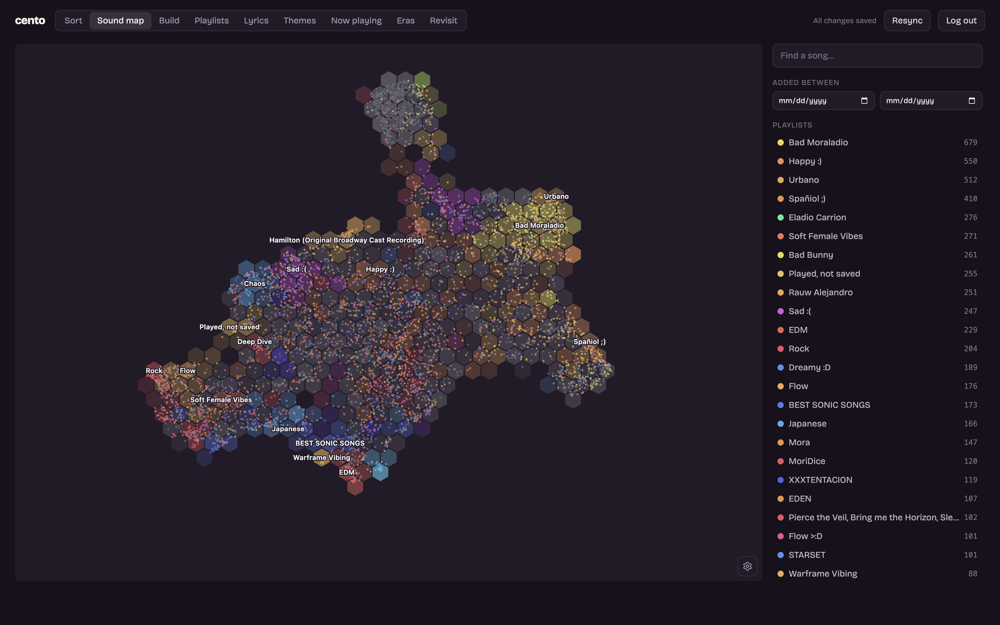
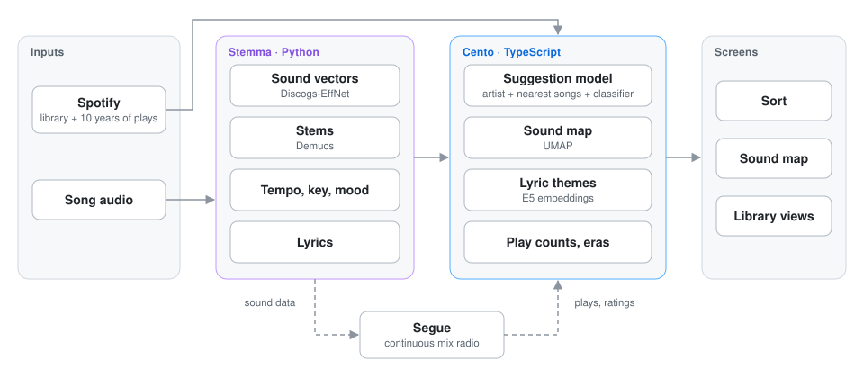

# Cento

Cento sorts a Spotify library into playlists. It learns from how ~5,000 songs were already sorted into 67
playlists, then suggests where each newly liked song belongs, using the song's artist, how it sounds and
what its lyrics are about.



## What it does

- **Sort**: plays each liked song and shows its likeliest playlists, with the confident ones already checked.
  One key sorts it.
- **Sound map**: lays out the whole library by sound, so similar songs sit together and each playlist shows
  up as a region. From any two songs it builds a playlist that moves gradually from one to the other.
- **Library views**: playlists grouped by genre, mood or lyric theme; listening "eras" found in ten years of
  play history; songs worth revisiting; a Now Playing screen for other devices.
- **Segue**: a companion radio that plays the library as one continuous beat-matched mix. It reads Cento's
  data and reports every transition, rating and play back to it.

## How it works



- A song's playlists are predicted from its artist's other songs, its nearest neighbors by sound and a
  per-playlist classifier trained on sound, lyric meaning and language.
- Audio analysis runs in Stemma, a separate Python engine: a 30 s preview or the full track goes through an
  ONNX music model, and full tracks are split into stems with Demucs. Stem separation runs nightly on a second
  machine, and each step resumes where it left off.
- A small always-on host records every play, refreshes all the data once a day, backs up what can't be
  regenerated, and receives Segue's events.

## Results

5-fold cross-validation on the sorted library (`pnpm eval`): each song is hidden in turn and its playlists are
predicted by a model trained on the rest. Recall@3 is the share of a song's real playlists that appear in the
top 3 suggestions.

| Recall@3 | All songs | Artist seen before | New artist |
| --- | --- | --- | --- |
| Biggest playlists (baseline) | 20% | 21% | 12% |
| Artist and playlist history | 79% | 89% | 13% |
| + nearest songs by sound | 85% | 90% | 55% |
| + sound classifier | **87%** | 91% | **62%** |

For artists never sorted before, history alone does no better than the baseline. Sound is what makes those
suggestions work. Suggestions the app checks for you are right 88% of the time.

## Stack

TypeScript, React, Vite, Tailwind, Zustand, Transformers.js and umap-js in the app and scripts; Node for the
host; Python with ONNX, Essentia models and Demucs in the audio engine.

## Setup

Needs Node 20+, pnpm, a Spotify app (Premium for playback control) and, for anything sound-related, the Stemma
engine.

`.env` (gitignored):

```
SPOTIFY_CLIENT_ID=...
SPOTIFY_REDIRECT_URI=http://127.0.0.1:3000/web_player
ENGINE_DIR=/path/to/Stemma
ENGINE_EMBED="uv run --project /path/to/Stemma audio-embed embed {input}"
ENGINE_EXPORT="uv run --project /path/to/Stemma audio-embed export {input} --out {output}"
ENGINE_MODEL=discogs-effnet   # label only
```

Playlist choices (the all-songs playlist, ignored copies) live in `src/core/config.ts`. Then:

```
pnpm install
pnpm export     # log in and sync the library into data/
pnpm audio      # sound vectors, neighbors and the map layout
pnpm classify   # train the per-playlist classifiers
pnpm dev        # http://127.0.0.1:3000
```

Everything Cento writes goes to `data/` (gitignored). The scripts' Spotify token is cached in
`~/.cache/playlist-sorter/token.json`, outside the project so the dev server can't serve it.

The full manual, with every screen, key and script, is in [docs/USAGE.md](docs/USAGE.md).

## Layout

- `src/core/`: shared by the scripts, app and host (Spotify client, library sync, suggestion model, audio index)
- `src/cli/`: the `pnpm` scripts
- `src/app/`: the React app
- `src/host/`: the always-on host (play recording, daily refresh, Segue's events)

## License

[MIT](LICENSE)
